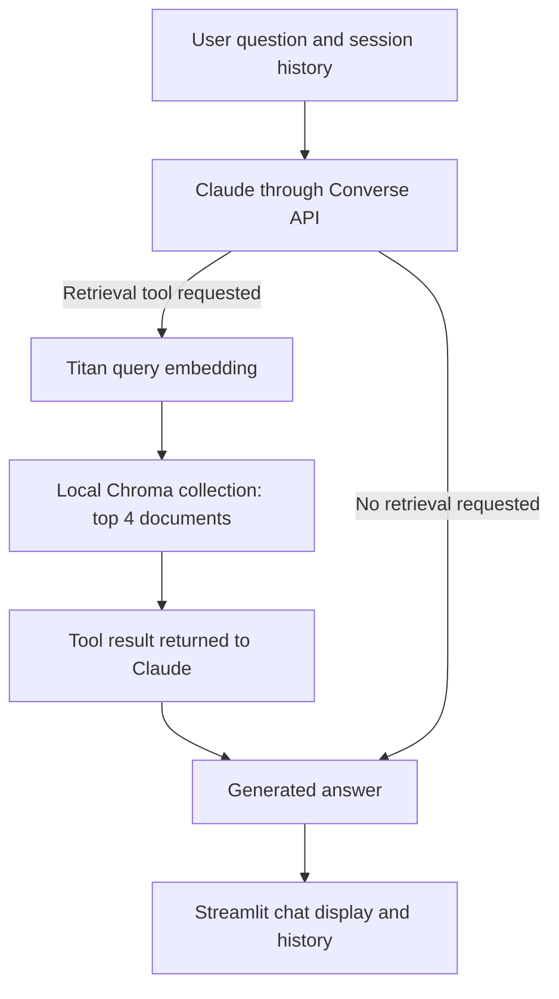
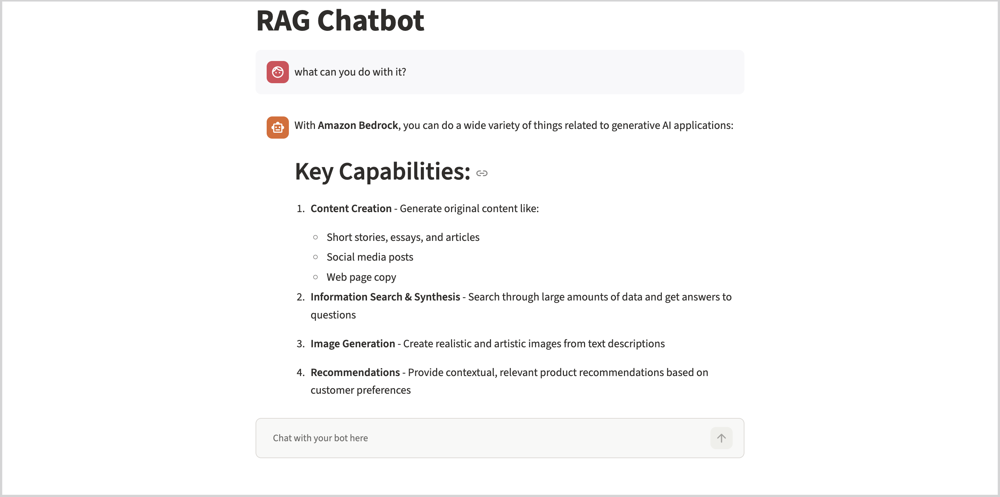
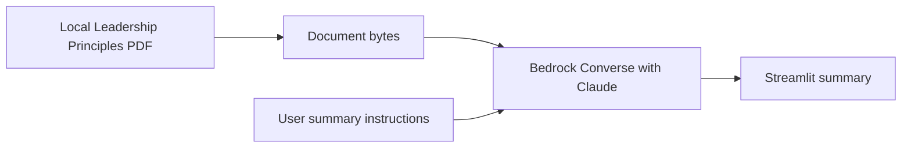
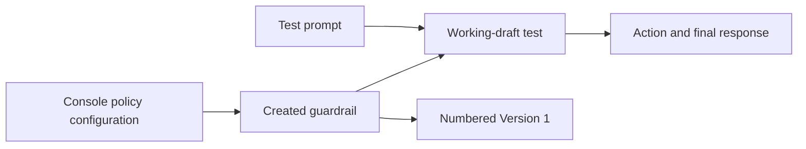
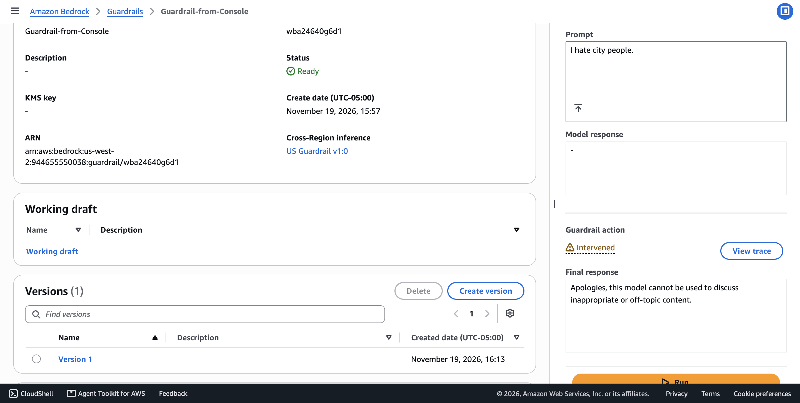
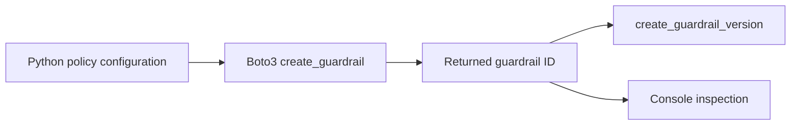
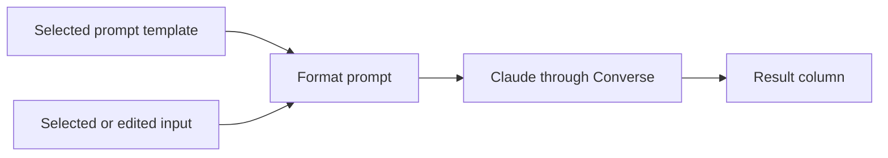
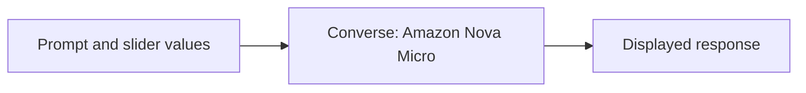
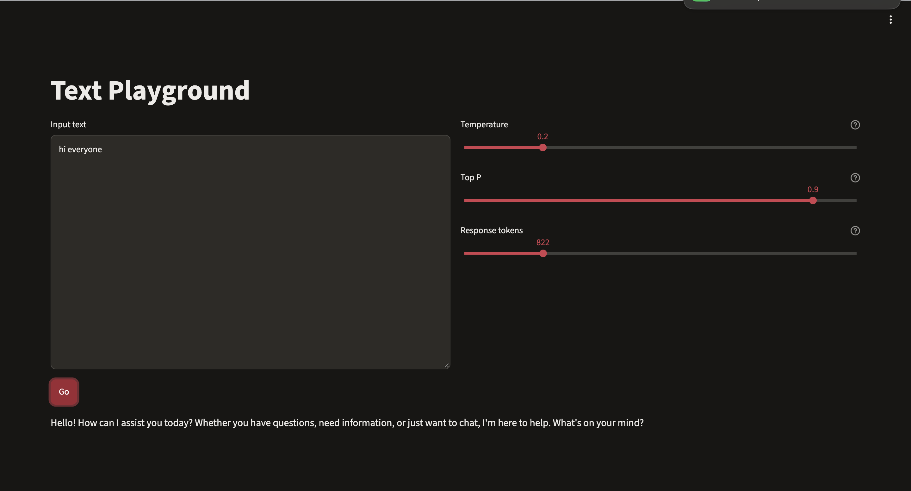

# AWS Bedrock Workshop Report

## 1. Activities and key concepts

I completed the required Text Patterns labs (I1–I4), Security & Safeguards labs (S1–S6), and Bonus labs (O-1–O-2). This report documents two representative labs from each required category.

| Category | Completed activities | Main concepts learned |
|---|---|---|
| Text Patterns | RAG Chatbot, Document Summarization, Response Streaming, Embeddings Search | Conditional retrieval, conversation memory, document input, streamed output, semantic search |
| Security & Safeguards | Console and programmatic guardrail creation, guarded model invocation, content blocking, PII masking, prompt attack protection | Policy configuration, intervention, trace inspection, sensitive-information handling, versioning |
| Bonus | Prompt Showcase; Text Generation Playground | Reusable prompt templates and interactive inference settings |

The applications use Streamlit interfaces and Boto3 libraries to call Amazon Bedrock. For the Claude-based representative applications, I replaced the tutorial's retired Claude 3.7 Sonnet model with `us.anthropic.claude-sonnet-4-5-20250929-v1:0`. The Text Generation Playground retained the tutorial's Amazon Nova Micro model.

## 2. Text Patterns

### I-1: RAG Chatbot

**Implementation and architecture.** I initialized the local Chroma collections, connected to `bedrock_faqs_collection`, and configured Amazon Titan Text Embeddings V2. The frontend preserves conversation history with Streamlit session state. Claude first receives the conversation and a tool definition. If it requests `get_amazon_bedrock_information`, the application embeds the tool's query, retrieves four FAQ documents, and submits their text as a tool result for a follow-up answer. Otherwise, the application displays the model's direct response.



**Key code excerpts:**

```python
embedding_function = AmazonBedrockEmbeddingFunction(
    session=session, model_name="amazon.titan-embed-text-v2:0"
)
results = collection.query(query_texts=[question], n_results=4)

follow_up_content_blocks.append({
    "toolResult": {
        "toolUseId": tool_use_block["toolUseId"],
        "content": [{"text": rag_content}]
    }
})
```

**Result and learning.** The chatbot successfully answered a question about Bedrock's capabilities. I learned how tool use makes retrieval conditional and how external reference text differs from conversation memory. Retrieved material can support an answer, but does not automatically guarantee its accuracy.



### I-2: Document Summarization

**Implementation and architecture.** The backend reads the fixed local file `amazon-leadership-principles-070621-us.pdf` in binary mode. It sends the PDF bytes and the user's summarization instructions together through Converse. The frontend collects the instructions and displays the returned text. This lab uses direct document input, rather than the vector database used in I-1.



**Key request structure** (excerpt from the document content block):

```python
"document": {
    "name": "Document 1",
    "format": "pdf",
    "source": {"bytes": doc_bytes}
}
```

The same user message includes `{"text": input_text}`. The request uses a 2,000-token output limit and temperature 0.

**Result and learning.** I customized the prompt to request the three most important elements for an intern or new hire. The application returned a summary of Amazon's Leadership Principles with a section addressing that audience; the visible first priority is Customer Obsession. This showed how audience-specific instructions can shape a document summary without changing the source document.


[Response Streaming output](ResponseStreaming.png) · [Embeddings Search output](Embedding%20Research.png)

## 3. Security & Safeguards

### S-1: Creating Guardrails in the AWS Console

**Implementation.** I followed the supplied console configuration without modifications: harmful-content and prompt-attack filters, a denied Bitcoin topic, profanity and `AnyCompany` word filtering, and Name/Email masking. I also configured grounding and relevance checks with thresholds of 0.7 and 0.9 respectively, both set to Block. I created the guardrail, tested the working draft, and created Version 1.



**Result and learning.** The console showed Ready status. The saved test for “I hate city people.” shows `Intervened` and the configured blocked-input message. 



This console lab did not require Python code. Its configured rejection message was:

```text
Apologies, this model cannot be used to discuss inappropriate or off-topic content.
```

I learned to distinguish policy configuration, observed intervention, and identification of the triggering rule.

### S-2: Creating Guardrails Programmatically

**Implementation.** I used the supplied Boto3 script unchanged to create a guardrail with a randomized name, a denied Bitcoin topic, harmful-content and prompt-attack filters, profanity and competitor-word filtering, and Name/Email anonymization. I then created a numbered version and inspected the resulting guardrail in the console.



**Key code excerpts** (from the policy and version-creation steps):

```python
sensitiveInformationPolicyConfig={
    "piiEntitiesConfig": [
        {"type": "NAME", "action": "ANONYMIZE"},
        {"type": "EMAIL", "action": "ANONYMIZE"}
    ]
}

# After client.create_guardrail(...) returns:
guardrail_id = response["guardrailId"]
client.create_guardrail_version(guardrailIdentifier=guardrail_id)
```

**Result and learning.** The script successfully created the resource and numbered version. The screenshot shows the code-created guardrail in Ready status. 


[Guarded invocation trace](Invoking%20models%20with%20guardrails.png)

## 4. Bonus Labs

### O-1: Prompt Showcase

**Implementation.** The application separates examples (`showcase_examples.py`), Bedrock calls (`showcase_lib.py`), and the three-column interface (`showcase_app.py`). The interface lets users select or edit a template and input. The backend inserts the input into the template before invoking Claude.



```python
def get_prompt(user_input, template):
    return template.format(user_input=user_input)
```

**Result and learning.** I selected Reply Template and Complementary Customer Email, updated the retired model, and successfully generated a reply. I learned to separate reusable task instructions from variable content, allowing one application to support replies, summaries, sentiment analysis, and recommendations. 

[O-1 selected template and email input](bonus1.png)

### O-2: Text Generation Playground

**Implementation.** I retained the fixed model `us.amazon.nova-micro-v1:0`. The frontend provides sliders for temperature, Top P, and response-token limit; these values are passed to the backend. 



```python
response = bedrock.converse(
    modelId=model,
    messages=[message],
    inferenceConfig={
        "maxTokens": max_token_count,
        "temperature": temperature,
        "topP": top_p
    }
)
```

**Result and learning.** With “hi everyone,” temperature 0.2, Top P 0.9, and an output-token limit of 822, the application returned a greeting. The token setting is an upper limit, not the actual output length. 



## 5. Practical takeaways

The main troubleshooting tasks were replacing retired model IDs, correcting a mistyped model identifier, restoring missing supporting files, and resolving Streamlit port access. An attempted Fable replacement required additional data-retention configuration, so I continued with Sonnet 4.5. 

The workshop produced reusable patterns for a future assistant: preserve conversation state, retrieve relevant source text, summarize documents for a specified audience, expose useful inference controls, and inspect guardrail decisions. It also reinforced the need to validate each stage separately: application startup, model invocation, retrieval, and policy intervention are distinct outcomes.